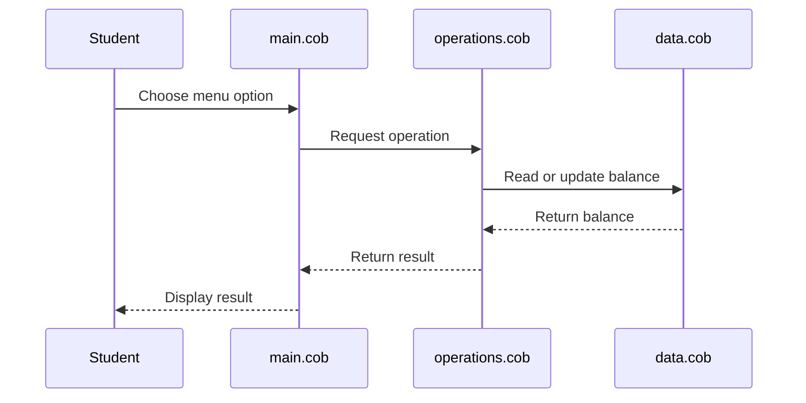

# Legacy COBOL Accounting System

## Purpose

The Mergington High School accounting system tracks student account balances for fees, cafeteria purchases, and school supplies.

## Files

- `main.cob` presents the menu and routes the user to account operations.
- `operations.cob` implements credits, debits, and balance inquiries.
- `data.cob` stores and retrieves the current student balance.

## Business Rules

Credits increase a student's balance, debits decrease it, and a balance can never be changed without a recorded transaction. The program validates menu choices and returns to the main menu after each operation.

## Data Flow

